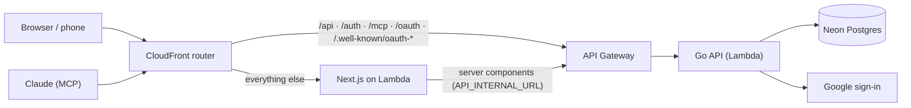

[← README](../README.md) · [Features](features.md) · [Getting started](getting-started.md) · [Your data](your-data.md) · [AI assistants](ai-assistants.md) · [Self-hosting](self-hosting.md) · **Architecture** · [Development](development.md)

# Architecture and costs

What you host, how a request moves through it, and what it costs each month.

**On this page:** [The deployment map](#the-deployment-map) · [What it costs](#what-it-costs) ·
[How a request flows](#how-a-request-flows) · [One handler, two homes](#one-handler-two-homes) ·
[Scheduled work and migrations](#scheduled-work-and-migrations) · [The stack](#the-stack) ·
[Design rules](#design-rules)

## The deployment map

Everything in the AWS box is serverless: nothing runs, and nothing is billed, while nobody uses the
app. [`sst.config.ts`](../sst.config.ts) defines all of it.

## What it costs

Estimated for **`sa-east-1` (São Paulo)**, the default and one of AWS's pricier regions, with
**October 2026 prices**. The assumed usage is a two-person household: about 30,000 API requests and
10,000 page loads a month, a 50 MB database and a daily job.

| Service                                 | What it does                          | Free tier                                     | Monthly cost                         |
| --------------------------------------- | ------------------------------------- | --------------------------------------------- | ------------------------------------ |
| CloudFront                              | Router and CDN in front of everything | 1 TB and 10M requests, **always free**        | $0, plus ≈ $0.04 per deploy          |
| Lambda (Go API, Next.js, jobs, migrate) | Runs all the code                     | 1M requests and 400,000 GB-s, **always free** | $0 (≈ $0.06 without the free tier)   |
| API Gateway (HTTP API)                  | Front door to the Go API              | 1M requests, **first 12 months**              | $0, then ≈ $0.06 ($1.59 per million) |
| S3                                      | Static assets for the web app         | 5 GB, first 12 months                         | < $0.01                              |
| SQS + DynamoDB                          | Next.js revalidation cache            | 1M requests and 25 GB, **always free**        | $0                                   |
| EventBridge                             | Daily schedule for the jobs           | Scheduled rules are free                      | $0                                   |
| CloudWatch Logs                         | Function logs                         | 5 GB, **always free**                         | $0                                   |
| Neon Postgres                           | The database                          | Free plan: 100 CU-hours, 0.5 GB per project   | $0                                   |
| GitHub Actions                          | Deploys                               | Free for public repositories                  | $0                                   |
| **Total**                               |                                       |                                               | **≈ $0.10 after the first year**     |

At **ten times that usage** the total stays under $1 a month: API Gateway is the only line that grows
past its free tier. Above Neon's free plan, its Launch plan bills by use (about $0.11 per CU-hour and
$0.35 per GB-month).

Each deploy also costs about **$0.04**. The router keeps its routes in a CloudFront KeyValueStore and
rewrites them on every deploy, and KeyValueStore API calls aren't in the free tier. A month with no
deploys costs nothing extra: a measured week of daily use, statement imports included, came to $0
outside the deploy days.

> [!NOTE]
> These are estimates from AWS's and Neon's published prices, not a quote. Prices change, so check
> the [AWS pricing calculator](https://calculator.aws/) and [Neon's pricing](https://neon.com/pricing)
> for your region. The app is served on its `cloudfront.net` address; a custom domain would add
> Route 53 and certificate costs.

## How a request flows

- The browser only ever talks to one origin, so the session cookie stays first-party.
- Server-rendered pages call API Gateway directly instead of going back through CloudFront.
- The API speaks [Connect-RPC](https://connectrpc.com): plain HTTP POST with JSON or protobuf, unary
  calls only, because API Gateway buffers responses.

## One handler, two homes

The Go API is one `http.Handler`, built in `backend/internal/server`:

| Where        | Entrypoint           | How it's served                                |
| ------------ | -------------------- | ---------------------------------------------- |
| Your machine | `backend/cmd/api`    | A plain `net/http` server on `127.0.0.1:8080`  |
| AWS          | `backend/cmd/lambda` | Wrapped by an API Gateway v2 adapter on Lambda |

Locally, Next.js proxies `/api`, `/auth`, `/mcp` and `/oauth` to the API, which is the same routing
CloudFront does in AWS. Nothing in the local setup depends on AWS.

## Scheduled work and migrations

- **Jobs** (`backend/cmd/jobs`) run daily from EventBridge. They top up recurring transactions three
  months ahead and purge expired imports. They're idempotent, so a missed day is harmless. Locally,
  `task jobs` runs them once.
- **Migrations** (`backend/cmd/migrate`, [goose](https://github.com/pressly/goose)) run on every
  deploy, from a Lambda, against Neon's direct host. They roll out next to the new API code, so they
  stay backward-compatible.

## The stack

| Layer   | Tech                                                                                      |
| ------- | ----------------------------------------------------------------------------------------- |
| API     | Go, [Connect-RPC](https://connectrpc.com) (protobuf via `buf`), `net/http`                |
| Data    | PostgreSQL, `sqlc` + `pgx/v5`, `goose` migrations                                         |
| Web     | Next.js (App Router, SSR), Tailwind v4, shadcn/ui themed with the Module/01 design system |
| Tooling | Bun workspaces, Taskfile, Biome, testcontainers-go, Playwright                            |
| Hosting | AWS Lambda + API Gateway (Go), OpenNext (Next.js), via SST; Postgres on Neon              |

## Design rules

These hold everywhere in the code, and they're why the numbers add up:

- **Money is integer minor units** plus an ISO 4217 code, never floats. Transfer rates are decimal
  strings in the API and `numeric` in Postgres.
- **Every row belongs to a household**, and every query filters by the household from the session,
  never from the request.
- **Today comes from the client.** Rows dated after it are upcoming: they never count in balances,
  reports or budgets.
- **The API is Lambda-safe:** stateless, with sessions in Postgres, configuration only from
  environment variables, and no background goroutines.

---

[← Self-hosting](self-hosting.md) · Next: [Development →](development.md)
