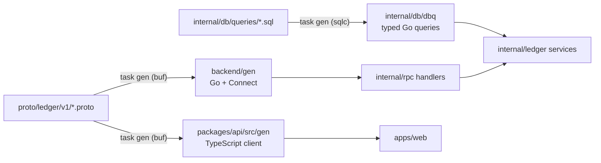

[← README](../README.md) · [Features](features.md) · [Getting started](getting-started.md) · [Your data](your-data.md) · [AI assistants](ai-assistants.md) · [Self-hosting](self-hosting.md) · [Architecture](architecture.md) · **Development**

# Local development

Everything runs on your machine: Postgres in Docker, the Go API, and the Next.js app. No AWS account
is needed.

**On this page:** [Prerequisites](#prerequisites) · [Quickstart](#quickstart) ·
[Google sign-in](#google-sign-in) · [Dev login](#dev-login) · [Common tasks](#common-tasks) ·
[Repository layout](#repository-layout) · [The API contract](#the-api-contract) · [Tests](#tests) ·
[Docs images](#docs-images)

## Prerequisites

- [Go](https://go.dev/dl/) (version in `backend/go.mod`)
- [Bun](https://bun.sh) and [Node.js LTS](https://nodejs.org) (Next.js build, Playwright, OpenNext)
- [Docker Desktop](https://www.docker.com/products/docker-desktop/) (Postgres + testcontainers)
- [Task](https://taskfile.dev)

On Windows: `winget install GoLang.Go OpenJS.NodeJS.LTS Docker.DockerDesktop Task.Task`.

## Quickstart

```bash
cp .env.example .env        # then fill in the Google OAuth client (see below)
task setup                  # install JS deps, download Go modules
task db:up                  # start Postgres
task migrate                # apply migrations
task dev                    # Go API on 127.0.0.1:8080, web on http://localhost:3000
```

On a fresh Ubuntu or Debian machine (a cloud VM, a dev container), `bash setup.sh` does all of the
above. It installs the toolchain, starts Postgres (Docker, or a native PostgreSQL 18 without it),
writes a development `.env` with the dev-only login on, and applies migrations. `START=1 bash setup.sh`
also runs `task dev`.

## Google sign-in

Create an OAuth client (type **Web application**) in the Google Cloud console and add
`http://localhost:3000/auth/google/callback` as an authorized redirect URI. Put the client ID and
secret in `.env`, and list the Google accounts allowed to sign in in `ALLOWED_EMAILS`.

## Dev login

To work without a Google OAuth client, set `AUTH_DEV_LOGIN=1` in `.env` (development only) and sign in
with any email listed in `ALLOWED_EMAILS`. The response sets the session cookie:

```bash
curl -i -X POST localhost:3000/auth/dev/login -H 'content-type: application/json' -d '{"email":"you@example.com"}'
```

The end-to-end tests sign in the same way.

## Common tasks

| Command                 | What it does                                          |
| ----------------------- | ----------------------------------------------------- |
| `task gen`              | Regenerate protobuf (Go + TS) and sqlc code           |
| `task test`             | Go tests (testcontainers Postgres) + `bun test`       |
| `task e2e`              | Playwright end-to-end tests                           |
| `task lint`             | `go vet`, `gofmt` check, Biome                        |
| `task jobs`             | Run scheduled jobs once (recurring top-up)            |
| `task build:lambda`     | Cross-compile the Lambda `bootstrap` binaries         |
| `task docs:render`      | Render the docs SVGs to PNG                           |
| `task docs:screenshots` | Capture the docs screenshots from a made-up household |

`task --list` shows everything.

## Repository layout

```
proto/          API contract (ledger.v1)
backend/        Go module: cmd/{api,lambda,migrate,jobs}, internal/*, gen/
packages/api/   Generated TypeScript client
apps/web/       Next.js app
docs/           These pages, the brand images and the screenshots
sst.config.ts   AWS deployment (SST)
infra/          AWS role for the deploy workflow (CloudFormation)
```

## The API contract

The protobuf files are the source of truth. Change them first, then generate:



Never edit generated code (`backend/gen`, `backend/internal/db/dbq`, `packages/api/src/gen`). CI fails
when it's out of date.

## Tests

- **Go integration tests** start a real Postgres with testcontainers, so Docker must be running.
- **Web unit tests** use `bun test`.
- **End-to-end tests** (`apps/web/e2e`) run Playwright against the real stack, on desktop and on a
  phone-sized screen, with the dev login.

## Docs images

The pictures in these docs are generated, so they can be refreshed after a UI change:

- `docs/brand/*.svg` are drawn with the Module/01 tokens. `task docs:render` turns them into the PNGs
  the docs embed, because GitHub doesn't load web fonts inside SVG images.
- `docs/screenshots/` come from `task docs:screenshots`. It restores a made-up household
  (`apps/web/docs-shots/demo-household.ts`) into a separate `docs@example.com` account and captures
  each page on the studio backdrop. It needs the database running, and it reuses `task dev` if it's
  up.

---

[← Architecture](architecture.md) · [Contributing →](../CONTRIBUTING.md)
